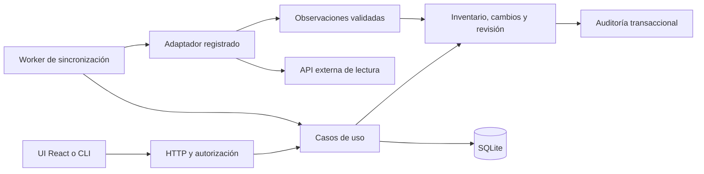

# Arquitectura del producto Go

**Estado:** SQLite es la autoridad de la primera instalación autohospedada,
por decisión del dueño del 16/11. Existe un primer servidor Go de laboratorio
con datos sintéticos y contratos de Personas/cobertura; no acredita un backend
productivo ni conectores reales. Ver [laboratorio Go](../server/README.md).

**Corrección del dueño, 22/10:** la UI original y la lógica Python existente
definen la experiencia y los contratos que deben preservarse. Las carpetas y
modelos propuestos aquí se ajustan a esa paridad, sin convertir Safes,
Personas, cobertura y postura en una sola tabla genérica. Cruces e inferencias
son capacidad central; ver [revisión existente](EXISTING-PRODUCT.md).

## Límites y distribución

Un monolito modular, un backend Go y SQLite como autoridad. Mantener
React/TypeScript/Vite y la experiencia existentes para la UI, preservando los
contratos HTTP durante la migración. El laboratorio debe usar fixtures de
esos contratos. Después, un mismo binario puede ofrecer comandos de servidor,
worker y migración, con procesos supervisados por separado cuando haga falta.
No introducir Redis, Kafka ni un servicio por proveedor para el primer flujo.

Propuesta de base técnica: `net/http` para HTTP; database/sql con modernc.org/sqlite (sin CGO); SQL explícito y migraciones
versionadas ejecutadas por un comando explícito. El laboratorio fija modernc.org/sqlite
v1.60.1 y Go 1.26 como mínimo. El receptor Ozal fija go-jose/v4 v4.1.9
(Apache 2.0) para verificar JWS EdDSA con claves públicas fijadas. La revisión de advisories y las pruebas
de operación empresarial siguen pendientes antes de distribuir la alfa.
Referencias primarias: [HTTP de Go](https://pkg.go.dev/net/http),
[database/sql](https://pkg.go.dev/database/sql),
[modernc.org/sqlite](https://pkg.go.dev/modernc.org/sqlite).



Los conceptos puros no dependen de HTTP, SQL ni SDKs. Los casos de uso
definen interfaces pequeñas; adaptadores resuelven SQLite, transporte y
proveedores. La carpeta `server/` aloja Go; la v1 permanece en su
checkout de referencia y no forma parte de este árbol limpio.

Estructura objetivo; el laboratorio actual implementa sólo cmd/custodia, coverage y lab:

```text
server/
  cmd/custodia/             composición, serve, worker, migrate
  internal/identity/       sesión y autorización
  internal/connections/    configuración y capacidades
  internal/inventory/      observaciones e identidad de registros
  internal/review/         responsable, estado y nota
  internal/sync/           ejecución, leases y completitud
  internal/audit/          eventos transaccionales
  internal/adapters/       SQLite, HTTP y conectores explícitos
  migrations/              historia nueva de la base del producto
```

## Persistencia y autorización implementadas en laboratorio

La migración aditiva 3 conserva las anteriores y transforma una vez el
snapshot sintético en conexiones, corridas y observaciones. Estas últimas
usan ID interno y restricción única por conexión, colección e ID externo
opaco. Los equipos apuntan a usuarios de su propia conexión; el correo exacto
forma candidatos sólo entre las fuentes del par con regla explícita.

Los principales se identifican por emisor/sujeto sintético, con habilitación
y concesiones de lectura por conexión. Cada consulta une observaciones con
las concesiones del principal habilitado dentro de una transacción SQLite;
no filtra un inventario global previamente unido. Totales y cobertura exigen
permiso de todas las fuentes y una regla vigente para el par. La metadata de
conexiones y fuentes también se limita al alcance legible.

Las credenciales secundarias se generan en el host y se almacenan por hash;
no prueban identidad empresarial. Emisión/revocación y preferencias propias
se auditan junto con el cambio. La credencial inicial no evade la habilitación
o las concesiones de su principal. Jobs/exports siguen sin implementación ni
permisos implícitos. Ozal tiene receptor firmado por petición y bootstrap
explícito; OIDC y la administración de conexiones/reglas quedan pendientes; ver [acceso](ACCESS.md) y [laboratorio](../server/README.md).

## Modelo mínimo

| Concepto | Responsabilidad |
|---|---|
| Tipo de conector | Código versionado: proveedor/herramienta, capacidades y contrato. |
| Conexión | Instancia configurada por el operador, alcance y referencias de secretos. Varias por tipo. |
| Colección | Familia que se sincroniza y reconcilia por separado. |
| Corrida/intento | Quién pidió, conexión, alcance/versiones, lease, progreso, errores y completitud por colección. |
| Observación | Clave externa, atributos permitidos, timestamps y corrida de procedencia. |
| Estado actual y cambios | Proyección verificable sobre observaciones; cambios explicados entre alcances comparables. |
| Revisión | Responsable, estado, nota y versión del cambio humano. Nunca payload externo. |
| Vínculo | Relación explícita con regla/origen/versionado y autorización en ambos extremos. No se requiere un grafo global. |

Identidad natural propuesta: **conexión + colección/tipo + ID externo**.
En SQLite debe existir una restricción única coherente con esa identidad.
Un ID interno no implica que recursos de distintas conexiones sean iguales.
IDs externos son opacos; no usar nombres, correo o IP como claves universales.

Los campos consultados se tipan y validan; atributos específicos pueden usar
JSON validado con allowlist y versión de esquema. No convertir todo en un documento
sin restricciones ni persistir payloads completos. Índices de conexión,
estado, paginación e historia se diseñan a partir de consultas reales; también
indexar claves foráneas usadas en joins. Tipos SQL y migraciones concretas se
cierran con el primer recorrido, no en esta revisión.

## Reglas de escritura y concurrencia

Una extracción larga escribe staging acotado; no mantiene una transacción
abierta mientras espera la red. El modelo de la demo permite actualizar lo
observado en una parcial, marcando su evidencia y cambios como parciales,
sin reemplazar la última línea base completa. Sólo un conjunto completo y de
alcance comparable respalda reconciliar ausentes como retirados. Este contrato
debe contrastarse con el flujo Python correspondiente antes de adoptarlo en
Go: el fixture reducido no gobierna toda la migración. Un cambio de filtro, credencial
o configuración crea una nueva generación; no elimina por comparación con
otro universo. Una colección completa puede avanzar sin retirar datos de una
colección incompleta de la misma conexión.

Una sola instancia sobre un disco local. WAL, foreign_keys y busy_timeout
se configuran al abrir cada conexión; las escrituras usan transacciones cortas.
No se comparte el archivo por red ni se promete alta disponibilidad. El
laboratorio limita el pool a una conexión. El worker futuro debe demostrar
claim atómico y fencing persistidos en SQLite, con pruebas entre procesos;
un mutex en memoria no alcanza. No se trasladan advisory locks de PostgreSQL.
El backup deberá usar una copia consistente de SQLite, incluyendo el estado
WAL según el mecanismo elegido; copiar sólo el archivo abierto no es contrato
de recuperación. Verificar restore antes de distribuir la alfa.

Repetir el mismo resultado no duplica recursos, cambios ni auditoría. El
commit del estado publicado y su auditoría es atómico. Las ediciones humanas
usan control de versión para no pisarse; el sync no toca sus campos.

## Acceso, secretos y operación

Separar autenticación y autorización según [el contrato de acceso](ACCESS.md).
Recomendar Switchboard para la instalación del dueño y OIDC genérico para
una instalación independiente, con un solo modo activo y sin fallback local.
La integración Switchboard necesita identidad verificable por la app; no está
implementada por tener un túnel o headers. OIDC implica cliente y sesión
revocable de Custodia, no crear un proveedor de identidad. Roles son plantillas sobre
permisos de acción y alcance de conexión, aplicados en backend a listados,
detalles, exportaciones, jobs y auditoría. Un total tampoco revela datos de
una conexión que el usuario no puede leer. Separar lectura sensible de
administración de la instalación, preservando la segregación de la v1.

Referencias de secreto por archivo/entorno protegido; nunca guardar valores
resueltos en JSON de conexión, respuestas, fixtures o historial. Configurar
una conexión requiere un operador autorizado; el conector no expone un proxy
HTTP arbitrario. Diagnóstico mediante códigos seguros, no cuerpos externos.

Migración explícita como operación administrativa; el servidor sólo valida revisión.
El archivo y su directorio pertenecen a la cuenta del servicio; SQLite no
proporciona roles SQL separados para migrador y runtime. La
instalación Go usa un archivo nuevo independiente de la v1. No hay
backfill ni acceso a datos laborales por defecto. Si después se solicita una
importación, necesita contrato de campos, permisos y aceptación propios.

## Cómo se prueba

Regresiones de dominio sin red; contrato de adaptadores contra un servidor
local; SQLite descartable para transacciones, aislamiento, leasing y
concurrencia; UI contra fixtures y API real de prueba. Incluir dos conexiones
del mismo tipo con IDs externos iguales. Verificar instalación vacía,
upgrade y restore descartable antes del piloto externo. Una demo estática
no sustituye esas pruebas.

## Identidad firmada implementada

La migración aditiva 4 incorpora el marcador único del primer administrador,
sus roles y replay persistido de aserciones. No altera migraciones aplicadas.
serve selecciona explícitamente el receptor de Ozal y protege API y archivos;
serve-lab conserva su autenticador separado. El gateway identifica, Custodia
resuelve emisor/sub y decide lectura por conexión. El administrador no evade
esas concesiones. Alta/revocación de lectores y auditoría son atómicas.
El receptor no emite sesiones propias; el logout termina en Ozal por formulario
POST del navegador. La prueba usa un gateway efímero, no una instancia desplegada.
